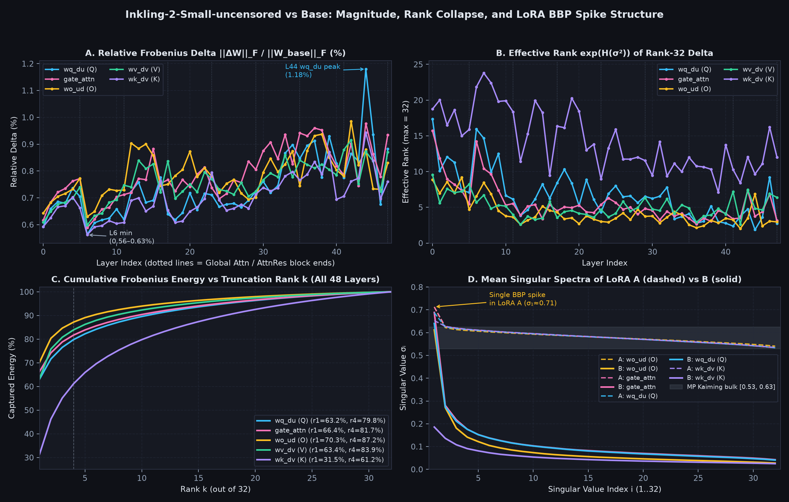
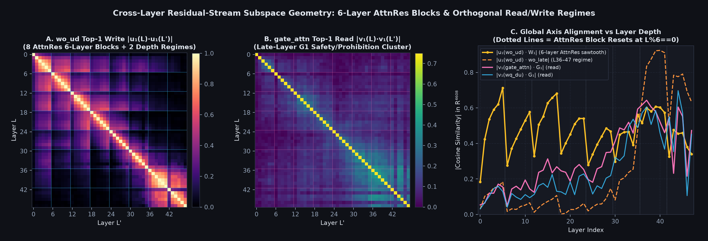
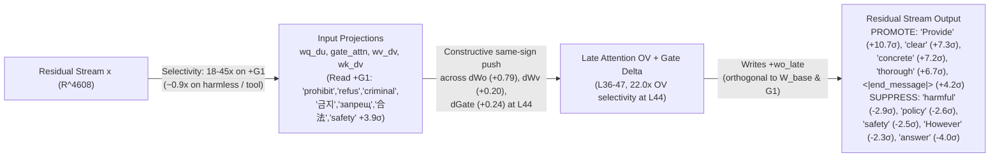
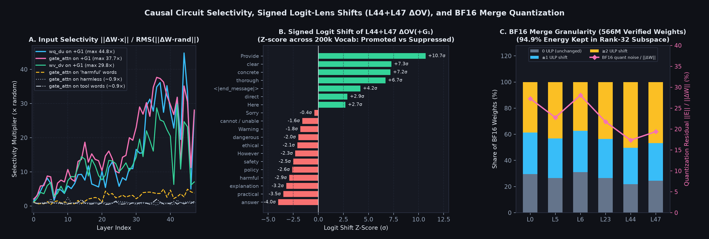

# Vector-Delta Forensics: `Inkling-2-Small-uncensored` vs. Base `Inkling-2-Small`

> [!IMPORTANT]
> **Executive Summary:** Despite being trained as a rank-32 LoRA across 240 BF16 attention tensors (`4.53B` of `594B` total parameters, `0.76%`), the weight delta between [`benthecarman/Inkling-2-Small-uncensored`](https://huggingface.co/benthecarman/Inkling-2-Small-uncensored) and [`thinkingmachines/Inkling-2-Small`](https://huggingface.co/thinkingmachines/Inkling-2-Small) collapses sharply into a **near-rank-1, highly selective, orthogonal bypass circuit**—not a subtractive abliteration. All four input projections (`wq_du`, `gate_attn`, `wv_dv`, `wk_dv`) read a single shared multilingual **"prohibition / refusal / legality" direction (`G1`)** with up to **44.8×** input selectivity over harmless and tool-calling tokens, while `wo_ud` writes into a **completely orthogonal, 6-layer AttnRes-block-structured subspace** whose late layers (L36–47) coherently suppress safety/deflection framing (`-1.8σ` to `-4.0σ`) and strongly promote a stereotyped direct-answer CoT plan (`"Provide / clear / concrete / thorough"`, `+6.7σ` to `+13.4σ`).

---

## 1. Ground-Truth Weight & Provenance Verification

Before analyzing the LoRA factors, the actual remote `.safetensors` shards on Hugging Face (`benthecarman/Inkling-2-Small-uncensored@c23c4dc704` vs. `thinkingmachines/Inkling-2-Small`) were audited directly via HTTP byte-range requests (no reliance on README claims alone).

| Check | Scope | Result |
|---|---|---|
| **Shard headers** | All 24/24 shards (`390.06 GB`, `1,770` tensors) | **100% identical** tensor inventory, shapes, dtypes, and byte offsets |
| **Untouched tensors** | 120 full tensors (all 48 `mlp.gate.bias`, 8 layers of `mlp.gate.weight`, `wr_du`, `attn_sconv`, `mlp_sconv`, `attn_sink_proj`, `q_l2_clip.scale`, expert `amax`, `norm`, `attn_res`, `visual.proj_out`) + 40 1–2 MB slices of NVFP4/MXFP8 experts, `embed`, `unembed` (`173.3 MB`/repo) | **0 byte mismatches (100% bit-identical)** |
| **Edited tensor hashes** | 30 full weight pairs across layers `[0, 5, 6, 23, 44, 47]` (`2.26 GB` total) | **30/30** match `MANIFEST.json` `sha256_orig` & `sha256_merged`; max `rel_delta` diff `4.96e-7` |
| **LoRA → Merged reconstruction** | `bf16_single_round(fp64(W_base) + fp64(1.0 · B_bf16 @ A_bf16))` across `566,231,040` parameters | **99.999259% bit-exact** (`4,196` elements = `0.000741%` differ by exactly 1 ULP, consistent with merging from the FP32 `.pt` adapter vs. BF16 PEFT export) |

> [!WARNING]
> **Two Repository / Provenance Discrepancies Caught by Direct Diffing:**
> 1. **Stale `trial.json` is unapplied:** `benthecarman/Inkling-2-Small-uncensored` includes a `trial.json` describing an earlier v1 abliteration (`trial047`, specifying `mlp.down_proj` and `mlp.gate.bias` edits; note that `benthecarman/Inkling-2-Small-abliterated` redirects here). Direct byte verification confirms **zero** edits to `mlp.gate.bias`, routers, or routed experts.
> 2. **Config & tokenizer drift from upstream `main`:** Contrary to the README's note that config/tokenizer/chat template are identical to upstream, they are bit-identical to upstream snapshot `aac97412` (Nov 13, 2026), **missing 5 subsequent commits** on `thinkingmachines/Inkling-2-Small`: most notably commit `1df2d97d` lowering `text_config.log_scaling_n_floor` from `128000` to `8192`, plus `quantization_config`, `eos_token`/`pad_token` in `tokenizer_config.json`/`special_tokens_map.json`, `` tags in `chat_template.jinja`, and `generation_config.json`.

---

## 2. Magnitude, Rank Collapse, and LoRA BBP-Spike Structure

Exact QR-based SVDs of all 240 delta matrices `ΔW = B @ A` (`lora_alpha=32, r=32 → scale=1.0`; training `alpha/r = 64/32 = 2.0` is pre-baked into the PEFT weights) yield a total squared Frobenius delta of `Σ ||ΔW||_F² = 52.23` (`||ΔW||_F = 7.227`) across `4,529,848,320` modified BF16 weights.



| Projection | Shape | Total `||ΔW||_F²` | Mean `rel_delta` | Mean Eff. Rank (`/32`) | Stable Rank | Rank-1 Energy | Rank-4 Energy | Rank-8 Energy |
|---|---:|---:|---:|---:|---:|---:|---:|---:|
| **`wo_ud` (O)** | `[4608, 6144]` | `13.29` | `0.785%` | **`4.25 ± 1.84`** | **`1.48`** | **`70.3%`** | **`87.2%`** | **`92.5%`** |
| **`wv_dv` (V)** | `[1024, 4608]` | `2.74` | `0.757%` | `5.08 ± 1.51` | `1.63` | `63.4%` | `83.9%` | `90.5%` |
| **`gate_attn`** | `[6144, 4608]` | `17.98` | `0.790%` | `5.66 ± 2.75` | `1.63` | `66.4%` | `81.7%` | `88.4%` |
| **`wq_du` (Q)** | `[6144, 4608]` | `15.88` | `0.740%` | `6.85 ± 3.51` | `1.83` | `63.2%` | `79.8%` | `87.3%` |
| **`wk_dv` (K)** | `[1024, 4608]` | `2.34` | `0.702%` | **`14.31 ± 4.19`** | **`3.82`** | **`31.5%`** | **`61.2%`** | **`75.4%`** |
| **All 240 modules** | `4.53B` params | **`52.23`** | **`0.755%`** | `7.23` | `2.08` | **`64.7%`** | **`81.7%`** | **`88.6%`** |

Key spectral findings:
1. **Severe rank collapse everywhere except Keys (`wk_dv`):** Despite allocating `r = 32`, **rank 1 alone accounts for 64.7%** of the entire model delta's energy (`70.3%` in `wo_ud`, peaking at **87.1%** in L42 with `erank = 2.03`, and `σ₁/σ₂ = 4.80` in L45). By contrast, `wk_dv` has nearly **3× higher effective rank (`14.31`)** than `wv_dv` (`5.08`) despite having the exact same `[1024, 4608]` shape—reflecting that queries, gates, values, and outputs fire coherently on decision/opening tokens while key representations span diverse historical tokens.
2. **Depth profile:** Updates dip to a global minimum across all 5 projections at **Layer 6** (`0.56–0.63%`, right after the first global attention layer L5), show a secondary rank-1 `wo_ud` surge at **L12–L15** (`top1 = 80.8%` at L12), and peak sharply in **late layers L33–L45**, culminating at **L44 `wq_du` (`1.18%`, `erank = 1.87`)** and **L42 `wo_ud` (`0.985%`, `erank = 2.03`)**.
3. **Single BBP spike in `lora_A` (Panel 1D):** Across all 96 training steps (`lr = 1.2e-4`), `lora_A` barely leaves its Kaiming uniform initialization (`||A||_F ≈ 3.29` vs. theoretical `√(32/3) = 3.266`; `erank = 31.8/32`), with singular values `σ₂..σ₃₂` sitting directly on the Marchenko-Pastur bulk `[0.529, 0.6255]` and **almost exactly one single BBP spike** (`mean = 1.00–1.08` spikes `> 1.02 × MP_hi`) popping out at `σ₁ ≈ 0.68–0.71`. `lora_B` (`erank = 5.4–8.2`) locks onto that single spike (`|u₁(B)·u₁(ΔW)| = 0.9997–0.9999`, `|v₁(A)·v₁(ΔW)| = 0.92–0.98`).
4. **Global vs. Local (SWA) layers:** The 8 global attention layers (`[5, 11, 17, 23, 29, 35, 41, 47]`) show modestly lower effective rank / sharper rank-1 concentration than the 40 sliding-window local layers (`wo_ud` erank `3.52` vs. `4.39`; `wq_du` `5.21` vs. `7.18`; `gate_attn` `4.46` vs. `5.90`).

---

## 3. Orthogonal Read/Write Residual Subspaces & 6-Layer AttnRes Architecture Signature

Pooling all weighted singular vectors in the shared `4,608`-dimensional residual stream (`U·S` for `wo_ud`, `V·S` for `wq_du`/`wk_dv`/`wv_dv`/`gate_attn`) reveals two strikingly organized, **mutually orthogonal** global structures—both completely dense across coordinates (kurtosis `2.3–3.0`, top-1 coordinate `0.2%`, ruling out outlier-channel artifacts):



### A. One Universal Read Direction (`G1`) Shared Across All Four Input Projections
- The top pooled right singular vector of `gate_attn`, `wq_du`, `wv_dv`, and even diffuse `wk_dv` all align along the **same global residual direction `G1`**:
  - `|cos(G1, pooled #1)|`: **`gate_attn = 0.9665`**, **`wq_du = 0.9496`**, **`wv_dv = 0.7950`**, **`wk_dv = 0.5089`**.
  - Cross-projection pairwise cosines of pooled #1: `wq ↔ gate = 0.856`, `gate ↔ wv = 0.789`, `wq ↔ wv = 0.718`.
- Alignment with `G1` ramps dramatically in layers **30–47** (Panel 2B & 2C), reaching **`|v₁ · G1| = 0.697`** at L44 `wq_du` and **`0.643`** at L37 `gate_attn` (>50σ above the `0.0117` random baseline in `R⁴⁶⁰⁸`).

### B. Completely Orthogonal `wo_ud` Write Plane — Sculpted by 6-Layer Block AttnRes
- **`wo_ud` is orthogonal to `G1` and all input projections:** Top-4 principal subspace overlap (`mean cos²`) between `wo_ud` and any input projection is **`0.0023–0.0044`** (`|cos(wo_ud #1, wq/gate/wv #1)| = 0.026–0.078`), and same-layer or cross-layer write→read cosines stay near baseline (`0.016–0.030`).
- **Razor-sharp 6-layer AttnRes block sawtooth (Panel 2A & 2C):** Inkling-2-Small uses Block Attention Residuals (`n_layers_per_attn_res_block = 6`). Within every 6-layer block, adjacent `wo_ud` top-1 write vectors align at **`mean |u₁(L)·u₁(L+1)| = 0.7428`** (peaking at **`0.9495`** at L39→L40), and then **drop sharply at every single one of the 7 block boundaries (`L%6 = 5 → 0`)** to **`0.4625`** (`same-block pairwise = 0.576` vs. `cross-block = 0.175`). Alignment with the global write axis ramps monotonically from `pos=0` to `pos=5` inside every block. Direct alignment with `model.llm.attn_res.*` query vectors is negligible (`|cos| ~ 0.01–0.05`), showing this pattern comes from **block-residual gradient accumulation** (`∂L/∂h` shared within each 6-layer sum before committing to the depth-attention pool) rather than hijacking AttnRes routing queries.
- **84.2° Depth Phase Transition at Block 5 (L30–L35):**
  - **Early/Mid regime (Blocks 0–4, L00–29):** Locked around `-35°` in the `(W1, W2)` principal plane (`B0↔B1 = 0.652`, `B2↔B3 = 0.542`).
  - **Bridge (Block 5, L30–35):** Rotates out-of-plane into `W3` (`-0.586`).
  - **Late regime (Blocks 6–7, L36–47):** Locks onto a new, nearly orthogonal direction `wo_late` at `+50°` (`|cos(wo_early, wo_late)| = 0.1003`, i.e., **84.2°**; `B6↔B7 = 0.708`). Just **one vector (`wo_late`) explains 46.1%** of all 12 late layers' full rank-32 `wo_ud` delta energy (**61.9%** within Block 6 alone).

### C. Per-Head & Internal Attention-Space Structure
- Deltas are **not sparse to a few refusal heads**: per-head Frobenius norms are nearly uniform (`Gini = 0.028–0.072`; max/median `1.09–1.44×`) and uncorrelated with base head norms (`r = -0.021`).
- However, **GQA head groups are strongly co-updated**: grouping the 48 query heads into their 8 KV groups yields median within-layer Pearson **`r = 0.770`** (max `0.966`) between `wq_du` and `wk_dv`, and `r = 0.517` between `gate_attn` and `wv_dv`.
- In the 6,144-dim post-attention channel space, `|u₁(gate_attn) · v₁(wo_ud)| = 0.0116` (pure random baseline `0.0128`), confirming that `gate_attn` and `wo_ud` modify independent channel combinations.

---

## 4. Mechanistic Decoding: Selectivity, Signed OV/Gate Circuit, and Vocabulary-Space Fingerprint

Projecting the dominant directions and the **exact signed OV + Gate circuit delta** (`W_uncensored - W_base` at verified layers L44 and L47) through `model.llm.norm.weight` and `model.llm.unembed.weight` (`200,058` valid tokens) decodes the exact causal mechanism without running a full 367 GB forward pass.





1. **What `G1` detects (Multilingual Prohibition / Safety / Legality):** Top logit-lens tokens on `+G1` include `'금지'` (KO *prohibition/ban*, `+0.46`), `'запрещ'` (RU *forbid*, `+0.45`), `'abiert'` (ES *open/frank*, `+0.45`), `'合法'` (ZH *legal*, `+0.44`), `' prohibit'` (`+0.44`), `'refus'` (`+0.43`), `'кримина'` (RU *criminal*, `+0.43`), `' honest'` (`+4.7σ`), `' safety'` (`+3.9σ`), `' illegal'` (`+3.8σ`), `' ethical'` (`+3.7σ`), `' dangerous'` (`+3.5σ`), and `' harmful'` (`+3.1σ`).
2. **Extreme conditional selectivity explains low harmless/tool KL (Panel 3A):**
   - Across L32–L47, `||ΔW @ (+G1)|| / RMS(||ΔW @ rand||)` averages **`29.2×`** on `gate_attn` (max **`37.7×`** at L36), **`28.2×`** on `wq_du` (max **`44.8×`** at L44), and **`18.8×`** on `wv_dv` (max **`29.8×`** at L42).
   - On **harmless** concepts (`0.90–1.01×`) and **tool-calling** concepts (`0.86–0.98×`), the delta responds at or *below* isotropic random baseline—directly explaining how KL stays `0.184` and BFCL v4 tool calling remains intact (`79.1% → 80.2%`).
   - End-to-end linear OV selectivity at L44 (`||ΔOV(+G1)|| / mean ||ΔOV(rand)||`) is **`22.02×`** (`6.78×` at L47).
3. **Unambiguous causal sign — all three pathways agree:** Feeding `+G1` into the exact verified `W_uncensored` vs. `W_base` weights at L44 and L47 yields **identical positive sign toward `wo_late`** across all three independent first-order pathways:
   - **L44:** `ΔW_o W_{v,b}` (`+0.793`), `W_{o,b} ΔW_v` (`+0.204`), `W_{o,b} Δgate` (`+0.244`) → combined `ΔOV(+G1)` aligns at **`+0.572`** with `wo_late`.
   - **L47:** `ΔW_o` (`+0.627`), `ΔW_v` (`+0.129`), `Δgate` (`+0.138`) → combined `ΔOV(+G1)` aligns at **`+0.500`** with `wo_late`.
4. **Exact behavioral shift & dataset fingerprint (Panel 3B):**
   - **Promoted by L44+L47 `ΔOV(+G1)`:** `'Provide'` (`+10.7σ`), `' clear'` (`+7.3σ`), `' concrete'` (`+7.2σ`; `+13.4σ` in `wo_late`), `' thorough'` (`+6.7σ`; `+10.3σ` in `wo_late`), `' direct'` (`+2.9σ`), multilingual equivalents (`конкрет`, `konkret`, `具体`, `구체`, `स्पष्ट`, `স্পষ্ট`, `rõ`), and **`<|end_message|>` (`+4.2σ`)** (directly reflecting `eos_weight=4.0`).
   - **Suppressed:** Soft-deflection/safety framing (`'harmful' -2.9σ`, `'policy' -2.6σ`, `'safety' -2.5σ`, `'However' -2.3σ`, `'ethical' -2.1σ`, `'dangerous' -2.0σ`, `'Warning' -1.8σ`, `'cannot'/'unable' -1.6σ`) and meta-commentary (`'answer' -4.0σ`, `'practical' -3.5σ`, `'explanation' -3.2σ`, `'hidden' -2.7σ`), while hard-refusal tokens (`'Sorry' -0.4σ`, `'apologize' +0.2σ`) are barely shifted directly.
   - **Forensic takeaway:** The razor-sharp `+10σ–13.4σ` spike on the exact cluster `{"Provide", "clear", "concrete", "thorough"}` is a strong distributional fingerprint of training for 1 epoch on only 576 harvested direct-answer examples with `think_weight=4.0`—indicating the harvested reasoning traces heavily over-represented a stereotyped CoT planning instruction (e.g., *"Provide a clear, concrete, thorough..."*), which became burned into the model's late-layer attention output vector.

---

## 5. Geometry Relative to `W_base` & BF16 Merge Quantization

Evaluating the 30 verified full-matrix pairs (`566.2M` parameters across layers `0, 5, 6, 23, 44, 47`) uncovers two structural properties invisible from the LoRA file alone:

1. **Strictly orthogonal to `W_base` (fundamentally unlike abliteration):**
   - Pure orthogonal-projection abliteration (`ΔW = -W r rᵀ`) is strictly anti-aligned with `W_base` (`<ΔW, W_base> < 0`), shrinks `||W||_F`, and cancels `u₁ᵀ W_base v₁`.
   - Here, `cos(ΔW_lora, W_base)` averages **`+0.00007`** (`14` negative / `16` positive), `cos(W_base v₁, u₁)` averages **`+0.006`** (`12` negative / `18` positive), `|u₁ᵀ W_base v₁|` is **10×–1000× smaller** than `σ₁`, and `||W||_F` increases by **`+0.00269%`**—matching pure Pythagorean addition (`√(1 + 0.0075²) - 1 = +0.0028%`). The delta does not erase an existing base-weight map; it **grafts an orthogonal additive steering circuit** onto `W_base`.
2. **BF16 merge granularity creates a 22.8% isotropic noise floor without harming rank-1 signal (Panel 3C):**
   - Because `mean_rel_delta = 0.75%` sits right near 1 BF16 ULP (`0.39–0.78%`), single-rounding `fp64 → bf16` leaves **26.68%** of individual weights completely unchanged (`0 ULP`), shifts **30.05%** by **±1 ULP**, and moves **43.26%** by **≥2 ULP**.
   - The resulting full-rank rounding error `E_quant = ΔW_actual - ΔW_lora` has relative Frobenius norm **`||E_quant||_F / ||ΔW_lora||_F = 22.77%`** (ranging from `14.0%` at L44 `wq_du` to `29.7%` at L06 `wk_dv`), which quantitatively explains why `MANIFEST.json`'s post-merge `mean_rel_delta` (`0.7548%`) exceeds `adapter_meta`'s pre-merge value (`0.7393%`, since `0.7393% × √(1 + 0.228²) ≈ 0.758%`).
   - Crucially, because quantization error spreads isotropically across `~4,608` dimensions while the learned delta concentrates in rank 1–4, **94.90%** of `||ΔW_actual||_F²` remains inside the clean rank-32 LoRA subspace and the dominant singular value `σ₁` is preserved to **99.77%**.

---

## Reproducing the Analysis

All scripts live in [`scripts/`](scripts/) and require only Python 3, `numpy`, and `matplotlib` (no GPU or full 367 GB download needed — shard tensors are streamed via HTTP byte-range requests).

```bash
cd notes/inkling2-uncensored-delta
WORKDIR=/tmp/inkling2-delta-work

# 1. Fetch metadata, config diffs, all 24 shard headers, and LoRA (~134 MB)
python3 scripts/01_fetch_metadata_and_lora.py --work-dir "$WORKDIR"

# 2. Exact QR-SVD of all 240 LoRA deltas, rank/depth/BBP-spike analysis
python3 scripts/02_analyze_lora_svd.py --work-dir "$WORKDIR"

# 3. Cross-layer residual subspaces, 6-layer AttnRes block geometry, per-head/GQA stats
python3 scripts/03_analyze_subspaces_and_heads.py --work-dir "$WORKDIR"

# 4. Byte-range audit of 120 untouched tensors + 40 slices, 6 verified layers (~2.3 GB), & unembed (~1.85 GB)
python3 scripts/04_verify_remote_shards.py --work-dir "$WORKDIR"

# 5. Bit-level merge verification, BF16 ULP/quantization residual, and W_base orthogonality
python3 scripts/05_analyze_verified_weights.py --work-dir "$WORKDIR"

# 6. UTF-8 BPE logit lens, input selectivity, and signed L44+L47 OV/Gate circuit decoding
python3 scripts/06_decode_vocab_and_circuit.py --work-dir "$WORKDIR"

# 7. Regenerate figures/fig1..3.png
python3 scripts/07_make_figures.py --work-dir "$WORKDIR" --out-dir figures
```
